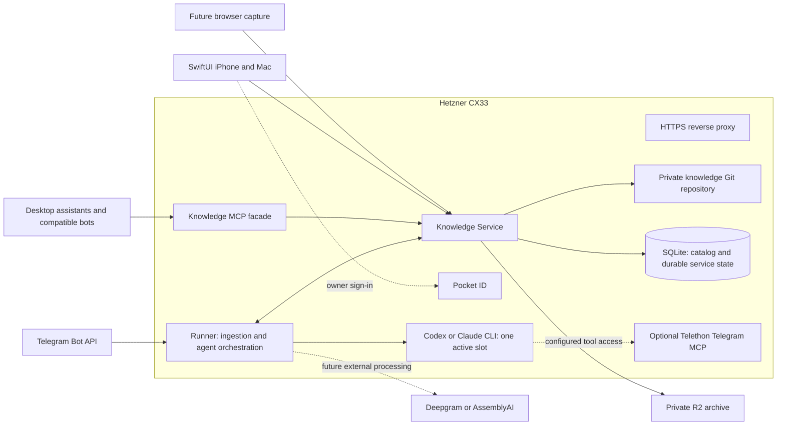

# Personal Wiki: product and architecture brief

**Date:** 2026-10-18. **Status:** input to planning; application implementation has not started.

This document consolidates the owner's discussion and accepted choices, including the final stack decision and subsequent selections of GitHub Actions, GitHub Issues, and Pocket ID. It supersedes the earlier HTML concept where that concept still presents rejected or unresolved alternatives as current.

Read this as four distinct kinds of information: **requirements** describe desired behavior; **owner decisions** are the agreed starting constraints; **proposals** describe a design to resolve through wayfinder; **evidence** describes experiments already performed. Proposed internals and acceptance criteria are not completed features.

## 1. Purpose and user experience

Build a custom, single-owner knowledge base for collecting, understanding, connecting, and revisiting useful material. The main activity is collecting sources and asking assistants to work with them. Manual note authoring is secondary.

The library remains available while the owner's computer is off. Cloud agents can process new material, publish notes, and answer questions independently of desktop clients. The owner reads through dedicated iPhone and Mac apps or asks assistants to retrieve and synthesize knowledge.

The product should accumulate an evolving wiki: a new source can create a note, improve an existing topic, or expose a disagreement. It should avoid producing an isolated summary for every saved URL without connecting the resulting knowledge.

### Core flows

1. **Save:** send a URL, text, or message to a bot. Receive a durable acceptance/status response. An agent prepares linked notes and publishes a batch. Newly published notes become visible on both native clients.
2. **Read:** open folders, recent notes, related notes, and sources in the native app. Download the text library and read or search it offline. Retain a clear indication of the last synchronized revision.
3. **Ask:** ask Codex, Claude Code, or a compatible bot what the library says about a subject. The assistant retrieves relevant material and returns an attributed answer with links to notes. Saving the answer is a separate intentional publication.
4. **Follow a link:** tap a private note link from a bot. The app opens the corresponding stable note ID, using the local copy or authenticated retrieval. Possessing the URL does not grant access.
5. **Inspect provenance:** move from a note to the captured source text, original URL, available translation, or retained media. A summary and its source remain distinguishable.
6. **Maintain:** an agent periodically checks affected areas for stale links, contradictions, duplication, and outdated topic pages. Ordinary bounded changes may publish automatically; major restructuring requires separate review.

The first user-facing source is an **X post or author thread with discussion, captured through Apify**. The owner chose it because it is the most frequent real workflow. Plain text and Markdown remain useful normalized representations and test fixtures; general HTML ingestion and additional PDF, video, and audio processors can follow without redesigning storage and publication.

## 2. Owner decisions

These are input constraints for planning. Reopen one only when new evidence justifies a specific discussion with the owner.

| Area | Accepted starting decision |
| --- | --- |
| Hosting | Existing Hetzner CX33 in eu-central: x86, 4 shared vCPU, 8 GB RAM, 80 GB NVMe. |
| Authority | The server controls the canonical library and publication. Client copies are replicas. |
| Text and versions | Markdown files in folders, with Git recording complete batches of changes. The knowledge Git repository is private and separate from this public code repository. |
| Format direction | Markdown plus a basic OKF 0.2 profile. The precise application metadata schema still needs definition. |
| Originals and media | Private Cloudflare R2 storage, linked to notes through durable provenance metadata. |
| Server applications | Separate Knowledge Service and Runner. Storage and publication belong to the service; research and agent execution belong to the Runner. |
| Agent providers | Support both Codex and Claude Code through adapters. Start the proposed real-agent slice with Codex. Use the owner's account/subscription-based CLI access. |
| Agent concurrency | One global product-agent job at a time across providers, including ingestion and maintenance work. |
| Server stack | TypeScript + Effect 4; Bun as runtime and package manager; moon + mise; Effect SQL + SQLite; Effect PersistedQueue backed by SQL. |
| Code quality | Oxlint and Oxfmt. |
| CI | GitHub Actions. Runner choices and cost controls remain implementation decisions within that platform. |
| Work tracking | GitHub Issues and Matt Pocock's skills flow. Beads is not part of the selected setup. |
| Authentication | Pocket ID as the OIDC provider. Client flows and authorization rules still need concrete design. |
| Native clients | Custom SwiftUI applications for iPhone and Mac, initially read-only. Obsidian is not a client dependency. |
| iPhone delivery | TestFlight for personal use; no public App Store release is planned. |
| Offline search | Bootstrap with a server-built searchable snapshot, then apply incremental updates and maintain the local index. |
| Publication policy | Ordinary bounded updates may publish automatically. Major restructuring has a separate review path. |
| Transcription | Outside the first slice. If added, use Deepgram or AssemblyAI; no local transcription on the VPS. |
| Clipper | Deferred and non-blocking. A fork is not selected; upstream Web Clipper file export plus an uploader remains an option. |
| First-slice completion | Develop and verify locally first; complete the slice on CX33 with the computer off. |
| First-slice interface | Minimal web interface for submitting a source, observing status, finding notes, and reading sources. Telegram and native clients follow. |
| First source | An X post/thread and its replies through Apify. Reuse `xquik/x-tweet-scraper` behind an adapter with independent coverage checks, following the representative capture pilot. |
| Capture limits | Configurable defaults: 50 main author posts, 200 discussion posts shared across modes, 30 additional parent/context lookups, and a five-minute acquisition window. Coverage limits remain visible. |
| Apify budgets | USD 0.25 per save/refresh job including retries; USD 5 per calendar month across Personal Wiki jobs. The future runtime must enforce shared reservations and accounting. |
| Note depth and citations | Retell essentially all substantive content of the main post, preserving its points, examples, qualifications, and attribution. Curate discussion separately. Place clickable links to the specific supporting X posts next to the corresponding statements. |
| Submitted focus | A deliberately selected reply is its own material with parent/root context. A resolved author continuation belongs to its author material; preserve the exact submitted anchor. |
| Save and refresh | Ordinary save returns the existing note or active job. Explicit refresh creates a new capture and may update the same stable note, retaining history; weaker captures do not silently erase knowledge. |
| Post and article | Separate connected notes and source identities. First-slice expansion includes one level of quoted context and one associated X Article; other website/media references remain explicitly unprocessed. |
| Partial outcomes | Publish useful, quality-checked main text with explicit gaps. Unavailable or unprocessable main material yields an actionable outcome without fabricated content or silent truncation. |
| First-slice write scope | Current material note, acquired article note, their provenance, and relevant existing-note links. Backlinks are derived; topic-page rewriting and restructuring follow later. |
| Stale publication | Reject the stale proposal; allow one persisted Runner rebuild from retained captures and current library context, without fresh Apify acquisition. A second conflict is actionable failure. |
| Rollback | Reverse the latest whole publication through a new compensating publication, retaining source evidence, stable identities and history. An operator command is sufficient initially. |
| Research depth | No additional research outside the submitted conversation in the first slice. The agent can use relevant existing library material. |
| Languages for development | English documentation, tickets, PRs, and code comments; Russian conversation with the owner. |

Go, plain Hono/TypeScript, pnpm, and Drizzle were explored as alternatives. They are not the selected baseline. Effect SQL does not require introducing an ORM.

## 3. Domain model

The accepted [glossary](../GLOSSARY.md) and [X source identity and provenance contract](specs/x-source-identity.md) establish the first-slice vocabulary, focus, repeat-save/refresh behavior, and minimal v1 identities. The table is a brief orientation; lifecycle and publication details still belong to their own decisions.

| Term | Meaning |
| --- | --- |
| Source | A logical external material: an article, post, thread, message, or recording. |
| Capture | A particular retained snapshot of a source, with acquisition time and explicit completeness. |
| Asset | Retained bytes such as HTML, JSON, a PDF, or media, identified independently of an expiring download URL. |
| Representation | A text form derived from a capture: extracted original text, transcript, or translation. It is not a new independent source. |
| Note | An attributable explanation or synthesis, potentially based on several sources. |
| Topic | An evolving page connecting knowledge across notes and sources. |
| Job / attempt | A durable request and one bounded execution of that request. |
| Proposed changeset | An agent's suggested batch against a known library revision, subject to service validation. |
| Publication | An accepted batch, its Git revision, operation identity, and durable result. |
| Replica | A client's locally readable version of a published library revision. |

The metadata model preserves stable identities across file renames and moves. Source links, capture identity, and derivation relationships must survive rebuilding SQLite from the retained knowledge data. The identity contract defines the minimum versioned metadata and relation vocabulary; exact API serialization and remaining lifecycle/publication behavior are subsequent specification work.

## 4. Component topology

The high-level responsibilities are agreed; the internal APIs and packaging below are proposals to refine.



Public application endpoints sit behind HTTPS and authorization; the diagram emphasizes responsibility rather than individual network hops.

### Knowledge Service

Own canonical Git, SQLite, asset manifests, jobs, publication, read/search APIs, sync revisions, and delivery events. It is the only application component permitted to mutate the canonical library. Expose MCP as a facade over the same operations and authorization, not as a second implementation of library rules.

The service stores and serves knowledge. It does not own the LLM's research strategy or embed a model-specific research workflow into storage operations.

### Runner

Accept Telegram ingress, prepare inputs through processors, claim work through the service API, assemble relevant context, invoke trusted skills through an agent adapter, and submit a proposed changeset. Report progress, renew execution ownership, and clean up the CLI process on completion or cancellation.

Runner has no direct access to the service's SQLite or canonical Git repository. Temporary job workspaces are disposable and never become the published library by themselves. Asset transfer uses the service's authorized interface, potentially including scoped upload URLs.

### Agent adapters and processors

Codex and Claude adapters implement one project-level executor contract. Provider-specific process invocation, events, authentication, and errors stay inside adapters. The actual research runs in the selected CLI. A successful process exit is not a publication receipt.

A processor turns a capture into a common prepared-source result: normalized text, metadata, provenance, assets, completeness, and warnings. Keep extraction separate from the agent's interpretation. Simple processors can use TypeScript; specialized PDF/OCR/media processing can use a native binding or a separately supervised Python/Rust service when justified.

### Telegram and MCP

The Telegram Bot API ingress receives the owner's requests and reports status or note links. A Telethon-based Telegram MCP service is a separate planned integration for agent access to Telegram; it does not replace the ingress bot or own knowledge storage. Its session belongs in private service configuration.

The Knowledge MCP facade supports assistants that can actually connect to it. Grok-bot integration is desired, but its available MCP/authentication interface must be checked before promising a particular connector.

## 5. Storage, provenance, and publication

| Store | Data and authority |
| --- | --- |
| Private Git on VPS | Canonical Markdown, topics, normalized source text, available translations, durable metadata/provenance, and batch history. |
| Private R2 | Immutable original captures and binary assets. Git retains durable asset IDs, checksums, and metadata. |
| SQLite catalog | Rebuildable projection for document lookup, links/backlinks, FTS, and applied revision. |
| SQLite service state | Jobs, attempts, operation receipts, delivery state, and other durable operational records. This state needs backups; it is not all reconstructible from Git. |
| Client replica | Published text and a compatible local search index; optionally downloaded assets. |
| Temporary workspace | Bounded ingestion downloads, agent context, and unpublished results. |

The logical source of truth is the service-controlled library and archive. This spans Git, R2, and durable operational state; it is not a promise that one directory contains every recoverable datum.

### Portable knowledge format

Use readable Markdown and ordinary links with a small versioned metadata profile. The agreed OKF direction is a starting vocabulary, not a claim of full conformance or a ready-made sync engine. Define stable application IDs independently of paths, retain source/capture references, and record agent/skill provenance where meaningful.

Graph relationships live in files and metadata. The service derives backlinks and search projections. A separate graph database is unnecessary for the initial design. Exact folder taxonomy, metadata fields, and rename/merge redirect behavior remain to be specified.

Captured material can be incomplete. A Telegram preview must not be labelled a full article, and a single post must not be labelled a complete thread. Reacquisition creates a new capture; it does not silently replace the evidence behind an existing note. Preserve source statements, agent synthesis, and verification status as different concepts.

### Publication proposal and required invariants

An agent submits changes against a base revision with an operation identity. The service validates the allowed paths, document identities, references, and ready assets, then publishes a whole batch. Stale changes must be reconciled against current content rather than silently overwriting it. An ordinary rollback creates a new publication.

Git, SQLite, and R2 do not share a transaction. Design an operation journal and recovery procedure that make the following observable properties hold:

- Readers see a fully applied revision; no half-published batch appears through reads, search, or sync.
- A retry after a lost response returns the same publication result instead of creating duplicate notes or delivery events.
- Reuse of an idempotency key with different input is detected as a conflict.
- A committed operation can be reconciled after a crash, including catalog and event delivery state.
- Referenced assets are confirmed before publication. Expiring URLs are generated after authorization, not committed into notes.
- Accidental duplicate service startup cannot produce two active publishers.

The [atomic publication contract](specs/atomic-publication.md) defines the design: prepare verified assets and a journaled Git candidate, advance one canonical ref, then activate the catalog/FTS, applied revision, receipt, job result and outbox in one SQLite transaction. Readers use the applied revision while a committed batch awaits recovery. One exclusive writer owns the storage; replay returns the same receipt. Operational and projection tables share one physical SQLite database for this transaction boundary.

The contract also specifies the cancellation fence, one stale-base rebuild, latest-batch compensation, retained identities/evidence, crash cases and verification gates. This is a design, not proof that the implementation already satisfies it. Queue-level deduplication alone does not establish these guarantees.

## 6. Queue and agent lifecycle

Effect PersistedQueue backed by SQL is selected. The service owns it, and Runner consumes through an API. Delivery must be treated as at least once: publication deduplication and operation receipts remain separate responsibilities.

The one-slot constraint applies across Codex, Claude, ingestion research, and maintenance jobs. It does not limit how many development agents may work on this codebase.

The spike demonstrated a scoped HTTP lease adapter, but a lease does not guarantee that an old CLI process has stopped. Specify process supervision, startup reconciliation, ownership fencing, heartbeat failure, and cleanup before claiming the physical single-agent invariant. Distinguish intentional cancellation from a failed or unreachable worker; the former and latter have different retry semantics in the tested queue.

Persist enough state to distinguish accepted input, a running attempt, validation, publication in progress, completion, retryable failure, terminal failure, and cancellation. These are lifecycle requirements, not final enum names. Define cancellation's commit boundary so the UI never claims a publication was cancelled after it became durable.

The [capture/curation contract](specs/x-capture-curation.md) fixes the acquisition deadline and shared Apify budgets. CLI timeouts, repair/retry mechanics, model selection, capacity limits, and queue priority remain execution-design work. Account authentication or subscription limits should produce an explicit actionable state; an automatic paid API fallback is not part of the proposed design.

## 7. Reading, synchronization, search, and languages

### Read-only native clients

The initial iPhone and Mac apps provide folders, recent notes, search, a reader, related notes, and source navigation. The text corpus may be replicated in full; roughly 1 GB of text is considered acceptable. Large media can be downloaded selectively.

Synchronization happens inside the app. Opening an app after a bot publication should discover and retrieve the new revision without manual Git commands. Push or another notification mechanism is only a hint: reconnect and foreground refresh must repair missed notifications. Offline, retain the last complete usable revision and its working index.

Deep links address stable note IDs on the owner's domain. Native app association, login behavior, and link routing must be tested on real devices. A link should still open an already downloaded note offline when the platform delivers it to the app.

### Search and snapshot contract

Use server-side SQLite FTS for the initial lexical search. The accepted client approach is a server-built initial searchable snapshot followed by incremental updates; clients update their own local index for subsequent changes. This avoids downloading a whole index for every publication.

Define snapshot versioning, document/index revision consistency, atomic local activation, change cursors, deletions, and recovery when a cursor expires. Verify SQLite/FTS/tokenizer compatibility with the selected Apple library before treating a server-generated index as portable. Native clients do not have to expose a Git implementation to the user; their internal replica representation remains a design choice.

Lexical search is not semantic or cross-language retrieval. An online assistant can expand queries and synthesize answers. Multilingual embeddings or vector search can be added later if concrete retrieval tests justify them.

### Language requirements and unresolved policy

The owner wants to retain sources in their original language and read Russian notes or summaries. English originals should remain easy to open; Spanish, German, and other sources need an understandable Russian or English representation. The preferred working proposal is Russian knowledge text alongside the original.

The full translation policy is **not yet approved**. Decide which sources receive a complete Russian translation automatically, which are translated on demand, how long material is handled, and how versions/fragments are aligned. A summary is not a complete translation and cannot support search for details it omitted.

Index original text, notes, and available translations with language and representation metadata. Preserve original technical terms and explicit aliases where useful. Do not count a translation as independent corroboration, and do not promise arbitrary Russian queries will find an untranslated foreign-language detail offline.

## 8. Identity, privacy, and operations

Pocket ID supplies owner authentication through OIDC. The service must additionally restrict access to the intended owner identity and enforce client permissions. Native Authorization Code + PKCE and browser cookie sessions are proposed mechanisms; the exact client libraries and session policy remain open.

Give assistants, ingestion clients, and readers independently revocable credentials with appropriate capabilities. Reading/search, submitting a capture, requesting a job, and publishing are distinct permissions. Exact OAuth/MCP flows must match the clients actually used.

Unauthenticated users must not receive private note content, titles, search results, Git data, or assets. The exact 401/404 and owner login behavior can be resolved during API design. A note URL contains identity, not an access token. Raw HTML and generated Markdown must be rendered safely.

Trusted runtime skills and policy are separate from captured source content. Treat source instructions as data, keep canonical write authority out of the research process, and limit job context and credentials to what the task needs.

The library is private from other users; selected AI providers receive the material sent for processing. It is not an end-to-end encrypted system hiding data from its own server and processors.

Back up knowledge Git, durable service state, archive objects, and restoration configuration outside the VPS failure domain. Test a restore on a clean environment. A local replica and Git history alone are not the backup strategy. Define retention, asset garbage collection, disk limits, and backup objectives before routine use.

Run the initial deployment within the CX33's limits: one agent process, bounded temporary storage, remote heavy transcription, and observable resource usage. Measure real RSS, disk growth, and job duration on the VPS; container compatibility testing did not establish server capacity.

## 9. Tooling and repository direction

### Selected and verified server baseline

The selected stack is TypeScript/Effect 4, Bun runtime/package manager, moon, mise, Effect SQL/SQLite, PersistedQueue, Oxlint, and Oxfmt. Use one Bun lockfile. mise manages tool versions; moon manages the task graph and appropriate build caching.

The 2026-10-18 spike tested Bun 1.3.13, moon 2.6.2, mise 2026.9.1, and Effect/platform-bun/sql-sqlite-bun 4.0.5. These are a reproducible experiment baseline, not an instruction to use unreviewed latest versions. Pin the implementation's versions and verify upgrades. Some selected Effect APIs are marked unstable.

[The spike report](research/2026-10-18-stack-spike.md) records successful compatibility/failure probes and their limitations. Real Codex, cross-store publication, Pocket ID, R2, Apple clients, and deployment have not been proven by that spike.

### Proposed monorepo layout

Create modules when their boundaries are useful and exercised; the following is a target outline, not a request to scaffold every directory now.

```text
apps/
  knowledge-service/     # API composition, MCP facade, service startup
  runner/                # worker, ingestion orchestration, Telegram ingress
packages/
  domain/                # domain rules and types
  contracts/             # public schemas and interop fixtures
  library/               # publication, queries, jobs, sync
  storage/               # Git, SQLite, R2 adapters owned by the service
  ingestion/             # processor contract and initial X/Apify capture adapter
  agent-adapters/        # Codex, later Claude, and deterministic test adapter
  api-client/            # Runner and future capture clients
apple/
  WikiKit/               # shared reading, sync, search, models
  iOS/
  macOS/
skills/
  knowledge/             # trusted ingest/query/curate instructions for runtime agents
tests/                   # integration, recovery, interop, and end-to-end tests
ops/                     # containers, deployment, backup, release automation
docs/                    # brief, research, ADRs, runbooks, agent configuration
```

Runner imports contracts/client code, not service storage or the publisher. Apple clients consume a versioned public API, not server tables. Keep a single authoritative API schema; Effect Schema/HttpApi with generated OpenAPI/JSON Schema is the leading proposal and still needs integration verification.

Swift Observation + Swift Concurrency, GRDB, and Tuist + SwiftPM are preferences awaiting their own integration choices. Compose/systemd is the current deployment direction; Alchemy is optional and has not been selected. Browser capture packaging depends on its deferred design discussion.

### Agent-led development and CI

Use GitHub Issues for decision maps, specifications, and subsequently scoped implementation tasks. Keep decisions, implementation status, and runtime ingestion jobs distinct. Matt Pocock skills read the configuration under `docs/agents/`.

Autonomous delivery needs reproducible repository commands, clear module ownership, deterministic fixtures, and a visible verification result for the exact commit. Typechecking and Effect diagnostics should accompany lint/format checks; integration tests must exercise meaningful failure and recovery behavior. Product runtime skills and development-agent instructions have different audiences.

Use GitHub Actions for CI. Start with Linux checks for the server; add macOS/Xcode checks when Apple code exists. Reduce cost through affected-project selection, suitable caches, cancellation of superseded checks, and separating ordinary validation from release builds. The particular macOS runner and cache strategy remain open. Do not make paid live-agent calls part of every ordinary test run.

Release verified artifacts to staging before the primary deployment, with explicit migration and rollback behavior. Apple release automation must handle signing and TestFlight delivery separately. TestFlight builds have a limited lifetime; the earlier concept proposed a refresh around every 60 days within the 90-day build window. Verify the current distribution requirements when implementing that lane.

The owner supplies necessary accounts/access when an integration needs them and evaluates working versions. Credentials belong in private local, CI, or deployment configuration, never in issues or committed documentation.

## 10. First end-to-end slice: agreed boundary and proposed specification

The owner agreed the X-first source, bounded discussion capture, minimal web interface, and CX33 completion boundary during wayfinding on 2026-10-18. The contracts and acceptance details below still need resolution. Implementation begins after planning and authorization.

**Outcome:** submit an X post/thread URL; Apify captures the author material and bounded discussion; the original acquired material is retained; real Codex removes uninformative material from the derived reading result and proposes a Russian note with relevant wiki links; the service publishes the batch; the owner can search and read the note and inspect its captured source through a private minimal web interface on CX33.

Preserving the source archive and filtering the derived note are separate operations. Corrections, counterexamples, author clarifications, and meaningful disagreement must remain eligible for inclusion even when unpopular. Following review of the capture pilot, the owner accepted the overall direction and required a detailed Russian retelling of essentially all substantive main-post content, with selective discussion as a separate layer. Preserve the main post's individual points, examples, qualifications, and attributed claims; a short abstract can supplement this reading body but must not replace it. Do not impose a global summary word cap that silently drops substantive source details. This is a faithful paraphrase requirement, not a request to copy the source verbatim or an approval of automatic full translation of every linked article.

Inline citations must sit next to the statements they support and open the particular X post being referenced. A reply's claim links to that reply, not only the conversation root; a passage combining several posts links to each relevant post. Use captured stable IDs and validated source URLs rather than model-invented links. Retain provenance metadata as well as visible Markdown links. The accepted [capture/curation contract](specs/x-capture-curation.md) defines acquisition bounds, content selection, partial outcomes, Article scope, the two-note mutation boundary, and quality acceptance cases. General author-chain acquisition still needs its specified verification; a written policy is not implementation evidence.

The [Apify capture investigation](research/2026-10-18-apify-x-capture.md) documents the configured Actor's modes and limits. The [live pilot and owner feedback](research/2026-10-18-apify-x-pilot.md) support bounded direct replies plus search and parent repair, with explicit article expansion and independent graph/coverage validation. A post lookup alone does not establish conversation capture. Direct replies, nested discussion, and the author's self-reply chain need explicit handling. Provider completion does not prove exhaustive coverage; the pilot's unresolved cases remain explicit verification work.

### Suggested sequence and acceptance evidence

| Stage | Implement after planning | Verify |
| --- | --- | --- |
| Contracts and local foundation | Service/Runner boundary, domain contracts, migrations, request and operation identities, local environment. | Clean installation, deterministic commands, schema validation, no Runner SQL/storage access. |
| Durable capture and jobs | Accept an X URL, resolve the submitted post and conversation, run bounded Apify acquisition, retain dataset/diagnostics and source relationships, enqueue recoverable work. | Root and middle-of-thread inputs retain correct context; duplicate submission is idempotent; missing branches and capture limits are visible; external run identity supports recovery. |
| Real Codex execution | Adapter, trusted curation skill/context, structured proposal, progress, heartbeat, process supervision. | A genuine CLI execution preserves substantive main-post points, examples and qualifications; selected discussion has inline per-post citations; useful corrections survive noise removal; timeout, auth failure, cancellation, and killed-worker behavior are bounded. |
| Publication and recovery | Batch validation, Git history, operation journal, SQLite projection/search, delivery receipt. | A multi-file batch is visible as one revision; crashes around commit/index/ack recover without duplicate publication; stale proposals are rejected. |
| Read surface | A minimal web interface for source submission, job status, note list/read/search, and source inspection. | Saved content and per-post provenance are retrievable; inline citations open the correct X post; captured coverage and incompleteness are visible; original and generated material are distinguishable; unsafe markup cannot execute. |
| Private VPS staging | Linux/amd64 artifact, real R2 test namespace, private authenticated access, real Codex on CX33. | Resource measurement, restart/restore exercise, authorized reads, and denied unauthenticated reads. |

Start deterministic tests with a fake executor, recorded/synthetic Apify fixtures, and a local object-store adapter. Keep live Apify, Codex, and R2 checks separate and explicit; fake success does not count as integration evidence. Review actual note quality on a small representative set of conversations with the owner. Do not compare nondeterministic prose byte-for-byte.

Core failure cases include duplicate input, request timeout after success, stale base revision, repeated queue delivery, invalid agent output, agent termination, and service failure between Git commit and projection/event completion. Persist and reconcile an external Apify run through worker interruptions; a lost start response must not silently trigger unlimited new paid runs. Physical one-agent enforcement needs a real process-lifecycle test, not only a queue assertion.

Native apps, Telegram ingress, Claude's adapter, Knowledge MCP, and browser capture can follow this local path. The later delivery order is to be planned around validated contracts and useful user feedback; completing every planned client is not a condition for the first local slice.

## 11. Input to wayfinder

### Planning destination

Maintain a coarse product-wide inventory of scope bags and agree an implementation-ready specification for the X-to-wiki slice: domain/API contracts, capture/curation policy, recovery and authorization boundaries, and observable acceptance criteria through CX33 deployment. Use the agreed specification to create the subsequent implementation backlog; application implementation is a separate effort. The owner requested this overall scope-and-specification destination.

### Already precise questions worth considering

- What are the exact identities, schemas, and invariants for sources, captures, notes, jobs, proposals, and publications?
- What is the publication protocol across Git, SQLite, and R2, including visibility, idempotency retention, recovery, and publisher fencing?
- How does the Runner supervise a real CLI and preserve one physical agent slot through cancellation, restart, and orphan-process scenarios?
- Which Apify acquisition modes and budgets preserve author material and a useful discussion, and how are partial capture and per-post provenance represented?
- What qualifies as meaningful discussion, how is it distinguished from the author's claims, and how should the first Russian note reflect uncertainty and disagreement?
- What owner and machine authorization flows are required locally and for the first Pocket ID-protected deployment?
- What belongs in the first diagnostic read/search surface, and which acceptance cases decide that the slice is useful?
- Which versioned API and snapshot boundaries must be fixed now so native readers can be added without a storage rewrite?
- What are the staging, backup/restore, and GitHub Actions gates for the first deliverable?

These are candidate decision questions, not created tickets or an imposed dependency graph. Let wayfinder discover the needed dependencies and human decisions.

### Deferred, non-blocking work

- Additional external research beyond the submitted X conversation and existing library.
- General website ingestion, linked-article traversal, and a full browser-capture workflow.
- Browser capture: upstream Obsidian Web Clipper export/uploader versus a maintained fork; no Obsidian application dependency.
- PDF/OCR, YouTube, audio/video processors, and external ASR integration.
- Final full-translation policy, multilingual semantic search, and sophisticated fragment alignment.
- Full Apple UI, its concrete libraries, TestFlight automation, and broader device-level offline validation.
- Grok and Telethon integration details, full MCP client matrix, and additional agent providers.
- Manual editing, collaboration/multi-user access, visual graph exploration, and broad automated restructuring.
- Optional Alchemy deployment work and the public code license.

Pull a deferred detail into the first map only when it materially affects that map's destination. Do not reopen the selected server stack just because earlier research listed alternatives.

## 12. Background sources

These informed the discussion; they are not executable instructions or a substitute for version-specific implementation checks.

- [Andrej Karpathy's LLM Wiki idea](https://gist.github.com/karpathy/442a6bf555914893e9891c11519de94f).
- [Farza's wiki skill](https://gist.github.com/farzaa/c35ac0cfbeb957788650e36aabea836d).
- [The originally supplied OKF material](https://github.com/GoogleCloudPlatform/knowledge-catalog/tree/main/okf); verify the maintained specification before implementing the selected profile.
- [Recorded stack compatibility findings](research/2026-10-18-stack-spike.md).
- [Configured Apify Actor investigation](research/2026-10-18-apify-x-capture.md).

The evolving HTML concept and earlier experiments remain outside this new repository. This brief is the portable handoff and does not require access to the original chat or its local files.
