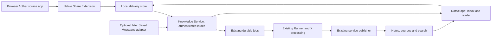

# Next product direction: Native Inbox + Share

**Date:** 2026-10-19. **Status:** owner-selected product direction; proposed macOS-first delivery and detailed slice scope await specification approval. This is planning input, not an implementation-ready specification or authorization to start another autonomous run.

The first [X-to-wiki slice](../specs/first-slice.md) remains unchanged. Complete its existing delivery and owner-acceptance gates. This document guides subsequent work and does not add requirements to P1–P13 or G1–G6.

## 1. Owner decisions and delivery recommendation

The next product capability is **Native Inbox + Share**, not a Telegram ingress bot. The intended macOS and iOS applications have equivalent product functions with platform-appropriate layouts. Both collect sources and read knowledge; neither initially edits published notes. Telegram Saved Messages ingestion is optional later work and does not block native delivery.

**Recommended sequence for owner review:** deliver macOS first, then iOS using shared Swift foundations. This lets the owner exercise intake, status, reading and recovery before adding the iPhone/TestFlight delivery lane. It does not prove iOS sharing, background delivery, authentication or offline behavior: each requires verification on its own platform. macOS distribution still needs an explicit installation/signing and extension-entitlement plan.

Native Inbox is an application capability backed by the existing Knowledge Service, not a third server application. Share Extensions are small platform targets; they do not run research, capture providers or Codex locally.

## 2. Proposed first native outcome

On the owner's Mac, share a supported X URL from a browser to Personal Wiki, or paste it into the app. The app retains the input, obtains durable acceptance from the existing service, shows processing state and opens the resulting Russian note(s). The existing server pipeline continues after the app closes. The client never needs direct access to knowledge Git or provider credentials.

Proposed first macOS boundary:

- Owner sign-in through Pocket ID using a defined native-client authentication contract.
- URL intake through a macOS Share Extension and an in-app paste/submit action.
- Durable local delivery with explicit distinction between device retention and server acceptance.
- Inbox list/detail with status, actionable errors and links to published results.
- A minimal native read-only library, server-backed lexical search, note reading and source navigation using the existing service capabilities.
- Stable note-link routing and a reproducible owner installation/update path.

Initially process only the already supported X inputs. The intake interface may grow to text and files later; neither accepting arbitrary URLs nor sharing them grants support for their source type. Show unsupported input explicitly rather than implying that general website extraction already exists. Sharing a URL does not transfer browser cookies, a complete page capture or access to a private source.

Full offline library replication/search, push notifications, additional processors, the Mac browser clipper and Telegram ingestion are separate work. Local durability of a submitted URL does not promise that the source itself has been captured or that published notes are available offline. The existing web reader remains available while native capabilities grow.

## 3. User-visible flow

1. **Capture:** choose Personal Wiki in the system share sheet or paste a URL in Inbox. Show what will be submitted. Do not require folder selection or note editing.
2. **Retain:** save the input locally before reporting that it was saved on this device.
3. **Accept:** send it to the authenticated service with a stable request identity. Only a durable service receipt permits the UI to say it was accepted by the server.
4. **Process:** reconcile service-owned status and expose existing eligible actions through the same API rules. Authentication renewal and transport retry are distinct from restarting paid source processing.
5. **Read:** link the incoming material to its published note or notes, or to an existing result for an ordinary repeated save. Notes remain independently available in the library.

Keep delivery state and processing state separate. Suggested presentation states, not a second authoritative job state machine:

| UI indication | Meaning |
| --- | --- |
| Saved on this device; waiting to send | The input is durable locally; the server has not acknowledged acceptance. |
| Sign-in required | The input remains retained; delivery awaits valid owner authorization. |
| Accepted / processing | A durable server receipt exists; job state comes from the service. |
| Ready | The service has returned published or already-existing result links. |
| Needs attention | Delivery or processing has an actionable failure or unsupported input. |

A Share Extension finishes after bounded retention/delivery work, rather than waiting for a note. Background transfer is an optimization; reconciliation when the app opens is the recovery path. Do not promise immediate delivery whenever connectivity returns without verifying the platform conditions. If input is still local, a closed application cannot imply that the server is processing it.

## 4. Ownership and contracts to specify



Use the service's current submission/job contracts where they fit; specify only necessary additions. Do not introduce a second ingestion queue or duplicate publication rules.

Three distinct concepts need an explicit mapping:

- **Incoming material:** the selected input and its delivery receipt. It may be accepted before extraction succeeds and may resolve to an existing result.
- **Ingestion job:** the existing durable capture/curation/publication lifecycle with existing budgets and execution ownership.
- **Published result:** one or more notes and their retained-source provenance.

These are proposed contract distinctions, not instructions to create three new database tables. Determine whether incoming material requires a new persistent record or can be represented by current receipts/jobs. Preserve the first slice's source identity, ordinary-save/refresh semantics and multi-note results.

Specify before implementation:

- Stable client request identity, replay after a lost response, conflicting payload rejection, and server-side deduplication when the same source arrives through multiple clients. A duplicate request must not trigger another paid job.
- Durable delivery across main-app/extension processes, interrupted writes, concurrent submissions and restarts. Coordinate consumption of shared storage rather than assuming only one process writes it.
- Server receipt and status reconciliation after reconnect/relaunch, including accepted work that finishes while the client is closed.
- A native authentication flow appropriate to an installed public client, exact owner binding, private credential storage, extension access, renewal, logout and revocation. Do not embed a confidential web-client secret or reuse browser cookies as the design.
- UI behavior for revoked access and retained local submissions/data, including shared storage and cached source text. Source-provider and VPS credentials stay on the server.
- Safe Markdown/source rendering and authorized asset retrieval under the same privacy rules as the web reader.

## 5. Shared Apple foundations

Target structure; create modules only when exercised:

```text
apple/
  WikiKit/                 # Swift package: models, API, intake/delivery, status, later replica/search
  macOS/                   # SwiftUI app and macOS Share Extension target
  iOS/                     # subsequent SwiftUI app and iOS Share Extension target
```

Share product behavior and tests: request/receipt models, idempotency handling, delivery reconciliation, status-to-view-state mapping, and later local replica/index logic. Share rendering components where appropriate. Platform adapters own authentication callbacks, secure/shared storage, extension integration, lifecycle and scheduling, link routing and distribution. macOS window/sidebar navigation and iPhone navigation can differ without defining separate products.

SwiftUI is selected. Observation/Swift Concurrency, GRDB and Tuist/SwiftPM remain preferences to validate, not newly fixed dependencies in this update. Use shared API fixtures to verify Swift decoding and server compatibility. Keep local pending submissions separate from the read-only knowledge replica.

The product's accepted offline direction remains a server-built initial searchable snapshot with incremental client updates. A separate replica contract must cover atomic activation, compatibility, cursors, deletions and offline source availability before claiming complete offline reading/search. macOS-first delivery should leave that boundary reusable for iOS without requiring the full replica in the first native increment.

## 6. Proposed verification and delivery stages

| Stage | Observable evidence |
| --- | --- |
| Native feasibility and specification | On the owner's Mac, a minimal signed/installed target receives an actual URL via sharing from the browsers the owner uses; native owner login and shared extension storage work. Confirm what payload each browser supplies. Agree the bounded native specification before autonomous implementation. |
| Shared intake behavior | Deterministic tests cover offline retention, app/extension contention, process termination, response loss, replay and expired authorization. No real provider spending in ordinary CI. |
| macOS vertical flow | Share or paste an X URL, observe durable server acceptance, close/reopen the app, then read the real server result and its sources. Repeat submission creates no duplicate paid work or notes. Unauthorized access remains denied. |
| Owner macOS acceptance | The owner can install the build, find the Share Extension, save from their actual browser, understand failures, search/read notes, and follow source links. Installation/signing evidence is part of acceptance. |
| iOS follow-on | Reuse shared logic; verify iOS authentication, Share Extension payloads, suspension/background behavior, deep links, layout and device installation through TestFlight on a real iPhone. macOS evidence does not substitute for this gate. |
| Offline-library follow-on | Verify the separately specified snapshot/delta/index contract, reading and search in airplane mode, and coherent recovery on reconnect. |

The native delivery plan must establish its own scope, credentials, spending bounds and gates. First-slice access preparation and its live campaign budget do not automatically authorize a new paid acceptance campaign. The future implementation backlog should follow specification approval rather than marking this planning outline ready for unattended execution.

## 7. Optional Saved Messages ingestion

The owner reports existing read-only Telegram MCP access. Keep it intact. Later, verify whether it exposes Saved Messages history, pagination, forwarded-content provenance and needed assets. A deterministic polling adapter can submit discovered material into the same service intake without an LLM just to detect new messages.

Proposed defaults for that later specification:

- Start from an explicit activation boundary; historical import is a separate action.
- Store discovery checkpoints and accepted-message identities in the service. Advance only after durable intake, independently of processing success.
- Repeated polling/restarts do not create duplicate work; processing failure of one item does not stall discovery of later items.
- Preserve available forwarded text and original references without inventing missing attribution or claiming a full source capture.
- Deleting a Saved Message does not delete published knowledge. Telegram write permissions are unnecessary for this intake design.
- Decide whether all newly saved material is eligible or a selection rule is needed. Unsupported types and unavailable/private sources have visible outcomes.

This is deferred direction, not a prerequisite for Native Inbox + Share. The existing Telegram MCP service remains distinct from the library's future Knowledge MCP facade.

## 8. Scope bags and remaining decisions

Existing product bags continue to group responsibilities; this document does not close or expand first-slice implementation issues:

| Bag | Updated direction |
| --- | --- |
| [Mac App](https://github.com/apshenichniy/personal-wiki/issues/10) | Recommended first native delivery: Inbox, Share Extension and read-only reading surface. |
| [iPhone App](https://github.com/apshenichniy/personal-wiki/issues/9) | Equivalent capabilities on shared Swift foundations, platform-specific UI/extension and TestFlight verification. |
| [Knowledge Library](https://github.com/apshenichniy/personal-wiki/issues/2) | Intake receipts/status and result relationships through the existing service boundary. |
| [Reading, Search and Sync](https://github.com/apshenichniy/personal-wiki/issues/6) | Native result access now; independently bounded offline replica/search later. |
| [Telegram](https://github.com/apshenichniy/personal-wiki/issues/7) | Optional Saved Messages intake/source retrieval; a Telegram ingress bot is no longer a planned prerequisite. |
| [Platform and Delivery](https://github.com/apshenichniy/personal-wiki/issues/12) | Native authorization, Apple checks and reproducible platform delivery. |
| [Browser Capture](https://github.com/apshenichniy/personal-wiki/issues/11) | Remains separate: system URL sharing does not implement a full-page clipper. |

Before producing implementation-ready issues, agree macOS-first sequencing and exact reading/offline scope; resolve the native auth contract, installation/signing approach, actual sharing behavior, API additions and bounded verification plan. Reconcile the affected scope-bag descriptions with the accepted PR during the next planning pass; their existing links and implementation status remain intact.
