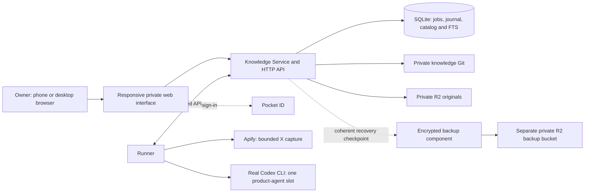

# First slice: X to a private reading library

**Status:** consolidated specification proposed for final owner approval, 2026-10-18. The linked behavior and delivery decisions are accepted. This document assembles their scope, acceptance and proposed implementation boundaries; application implementation has not started.

Approval ticket: [Approve the first-slice specification for task breakdown](https://github.com/apshenichniy/personal-wiki/issues/22). Planning map: [Specify the X-to-wiki first vertical slice](https://github.com/apshenichniy/personal-wiki/issues/13). Product context: [knowledge-base brief](../knowledge-base-brief.md), [glossary](../../GLOSSARY.md), and [Personal Wiki product scope](https://github.com/apshenichniy/personal-wiki/issues/1).

## 1. The result the owner should receive

From a private responsive web page, save an X post or thread. The server captures its main material and bounded discussion through Apify, retains the acquired evidence, and runs real Codex to prepare detailed Russian reading notes with inline links to supporting posts. The Knowledge Service publishes a coherent batch. The owner can see progress, find the notes through search, read them, follow related notes and inspect the retained source from a phone or desktop.

The deployed service must do this on the existing CX33 while the owner's Mac is off. The first slice delivers a useful collection-and-reading workflow. Native apps, Telegram, browser capture and conversational library questioning remain visible future components, not prerequisites hidden inside this release.

### Owner journey

1. Sign in through Pocket ID at `wiki.alexp.sh`; private URLs alone grant no access.
2. Paste an X URL and save. Receive a durable job identity or the existing note/active job for an ordinary repeated save.
3. Watch acquisition, preparation, curation and publication progress. Coverage gaps and actionable failures are visible. Eligible cancellation, resume and explicit refresh follow service-owned state; the UI cannot bypass budgets or execution ownership.
4. Open the published Russian note: a detailed main-material retelling, a separate selected discussion layer, exact inline citations and relevant existing-note links. An acquired associated X Article has its own connected note.
5. Switch to the captured original, see its capture date/coverage and open the external X source intentionally. Search active notes and associated original text through lexical search.
6. Return later and see new publications automatically through polling/foreground reconciliation. This web slice requires an online connection; native offline replicas follow later.

## 2. Components and ownership

Knowledge Service and Runner are the two application processes. The web interface uses the service API and can ship with the service; it does not require a third state-owning backend. Service-owned SQLite contains both durable operational state and the rebuildable projection. Runner never mutates that database or canonical Git directly. The agent proposes; only the service publishes. Deployment/backup authority and provider credentials are not available to source text or the Codex subprocess.

The selected baseline is **TypeScript + Effect 4, Bun runtime/package manager, Effect SQL/SQLite, SQL-backed Effect PersistedQueue, moon + mise, Oxlint/Oxfmt**. Use a single Bun lockfile and versioned HTTP/OpenAPI/JSON Schema contracts. Start from the [verified compatibility baseline](../research/2026-10-18-stack-spike.md), pin actual versions, and verify integration changes. GitHub Actions/Issues and Pocket ID are selected. No additional ORM, queue broker, vector database or orchestration platform is required by this slice.

## 3. Authoritative behavior contracts

These documents are part of this specification, not optional background. The short summary here does not override a more precise requirement in a linked contract. A contradiction must be resolved explicitly rather than choosing the easier interpretation.

| Contract | Defines |
| --- | --- |
| [X source identity and provenance](x-source-identity.md) | Stable source/note identity, submitted focus, immutable captures, separate articles, save/refresh and capture-pinned citations. |
| [X capture and note curation](x-capture-curation.md) | Capture strategy and limits, spending reservations, associated article/quote scope, partial outcomes, faithful Russian reading notes and allowed mutations. |
| [Atomic publication and recovery](atomic-publication.md) | Verified assets, operation journal, Git/SQLite activation boundary, writer exclusion, replay, stale-base rebuild and compensating publication. |
| [Execution lifecycle](execution-lifecycle.md) | Durable jobs/attempts/provider operations, queue handoff, one physical agent, supervision, budgets/deadlines, authentication blocks and retained-result recovery. |
| [Private reader and access](private-reader-access.md) | Three responsive views, source navigation, lexical search, Pocket ID owner binding, server-side sessions, private assets and safe rendering. |
| [Verification and CX33 delivery](delivery-verification.md) | Reproducible checks, real integration evidence, staging/artifact promotion, deployment privileges, resource observations, backups, restore and owner acceptance. |

### Release invariants at a glance

- Preserve acquired original material. Filtering applies to the derived note; provider completion never implies complete discussion coverage.
- Retell essentially all substantive main-source points, examples and qualifications in Russian. Keep useful corrections/disagreement; omit empty reactions. Link each attributed passage to its actual supporting post.
- Change at most the current material note, its acquired article note, their provenance and relevant links. No unrelated topic rewrites or external research. A partial refresh cannot silently erase stronger previously retained knowledge.
- Ordinary save is idempotent; refresh is deliberate. Stable identities survive path changes. A response lost after success does not create a second publication.
- Readers see one fully applied revision. The durable publication intent governs recovery after the cancellation fence; a late cancel cannot erase a committed batch.
- One global product-agent job runs across providers and live environments. Queue redelivery, process restart and deployment do not replenish attempt or spending allowances.
- Unknown Apify start outcomes are reconciled or blocked, never blindly repeated. Authentication/subscription problems do not trigger a paid API or alternative-provider fallback.
- Possession of a URL does not authorize reading. Anonymous private pages/APIs return generic 401; verified non-owners receive generic 404. Source assets remain protected as rigorously as notes.

### Accepted limits

| Limit | Starting value |
| --- | --- |
| Main author material / discussion / extra context | 50 / 200 / 30 posts; discussion is one shared deduplicated union across modes. |
| Acquisition | Five minutes; one level of quoted context and at most one associated X Article. |
| Apify cost | USD 0.25 per job, USD 5 per UTC month, and USD 2 total for the future live acceptance campaign within those limits. |
| Codex execution | 15 minutes per launch, 30 minutes per active job excluding initial queue wait, three launches shared by original curation and permitted recovery/rebuild work. |
| Stale proposal | One persisted rebuild from retained evidence/current library context; no fresh acquisition just to rebuild. |
| Web session | Revocable server-side session, at most 30 days absolute lifetime. |
| Backups | Daily encrypted incremental copies; seven daily/four weekly recovery points plus pre-migration copy; target RPO 24 hours and RTO four hours once operator/credentials are available. |

The execution contract additionally defines byte/context limits and the capture contract defines reservations. These are service-enforced policies, not prompt suggestions. Inability to fit required main material yields an explicit outcome rather than silent truncation or an unbounded multipass workflow.

## 4. Product-wide scope bags

A bag groups responsibility; it is not one implementation task or necessarily one deployable service. Completing this slice does not close an entire bag that contains later work.

| Existing bag | Included now | Retained for later |
| --- | --- | --- |
| [Knowledge Library](https://github.com/apshenichniy/personal-wiki/issues/2) | Portable identities/provenance, private Git, journaled publication, coherent projection and compensation. | Broader library authoring/maintenance needs beyond this write scope. |
| [Source Processing](https://github.com/apshenichniy/personal-wiki/issues/3) | X/Apify adapter, bounded capture, prepared source, original assets and X Article support. | General websites, PDF/OCR, YouTube, audio/video and ASR. |
| [Agent Runner](https://github.com/apshenichniy/personal-wiki/issues/4) | Durable service-owned jobs, fake and real Codex adapters, supervision and recovery. | Claude adapter and additional execution profiles. |
| [Wiki Workflows](https://github.com/apshenichniy/personal-wiki/issues/5) | Trusted X curation skill, faithful Russian notes, citations, meaningful discussion and related-note discovery. | Conversational synthesis, full translations, topic maintenance and restructuring. |
| [Reading, Search and Sync](https://github.com/apshenichniy/personal-wiki/issues/6) | Private web list/read/source/search, status and foreground/polling refresh. | Offline replicas, snapshots/deltas, native notifications and semantic retrieval. |
| [Platform and Delivery](https://github.com/apshenichniy/personal-wiki/issues/12) | Reproducible tools, Pocket ID, machine scopes, private R2, CX33/CI delivery, observation, backup and restore. | Apple release lanes and scaling beyond measured first-slice needs. |
| [Telegram](https://github.com/apshenichniy/personal-wiki/issues/7) | Preserve existing unrelated infrastructure; no new integration. | Owner ingress bot, query/status delivery and Telethon capabilities. |
| [Assistant Integrations](https://github.com/apshenichniy/personal-wiki/issues/8) | Preserve a provider-neutral API boundary. | Knowledge MCP and Codex/Claude/Grok client integration. |
| [iPhone App](https://github.com/apshenichniy/personal-wiki/issues/9) | No native implementation; phone acceptance uses the web reader. | SwiftUI reader, offline search, deep links and TestFlight. |
| [Mac App](https://github.com/apshenichniy/personal-wiki/issues/10) | No native implementation; desktop acceptance uses the web reader. | SwiftUI reader, local replica and desktop distribution. |
| [Browser Capture](https://github.com/apshenichniy/personal-wiki/issues/11) | Deferred, non-blocking. | Decide upstream Clipper export/uploader versus fork, then implement capture transport. |

## 5. Proposed implementation task boundaries

These are **reviewable task candidates, not created implementation issues**. After approval, turn them into independently executable GitHub issues with native dependencies, exact acceptance evidence and bounded ownership. Local labels below are only references within this proposal. Split a candidate further if code inspection shows it cannot be completed and verified in one agent session; preserve the observable outcomes and scope.

| Ref / proposed title | Deliverable and decisive verification | Depends on |
| --- | --- | --- |
| P0 — Prepare unattended execution access | Refresh private access inventory; finish owner-dependent login/passkey steps; establish scoped provisioning access for remaining app clients/backup resources and the acceptance budget record. Distinguish access readiness from an implemented deployment. Verify required credentials are usable without exposing them. | None; before an unattended run. |
| P1 — Establish a reproducible service-to-runner path | Pinned workspace and canonical repo commands; service/Runner processes communicate through versioned schemas/client; a synthetic round trip and generated-schema interop test run from a clean checkout. Linux CI uses no runtime credentials. | None. |
| P2 — Publish and read a retained synthetic source | Service-owned Git/SQLite/local-object adapter; v1 identities, retained assets and validated multi-file publication; read/search resolve one applied revision. Test checksums, duplicate operation replay and input-digest conflict. | P1. |
| P3 — Recover and compensate interrupted publications | Durable candidate/journal protocol, physical writer exclusion, crash reconciliation, stale-base rejection and latest-batch compensation. Inject failures at each publication boundary and prove no half-visible or duplicated batch. | P2. |
| P4 — Run a durable synthetic ingestion job | Service queue/state and scoped Runner API; fake executor goes from submission to publication receipt. Test duplicate save, explicit refresh, redelivery, blocked/expired/cancelled jobs, persisted allowances and recovery after a lost acknowledgement. | P3. |
| P5 — Prepare faithful X captures from fixture data | X URL/focus/author-chain resolution, multi-mode merge, article handling, provenance and normalized original representations under the common processor contract. Verify root/middle/reply, gaps, corrections and shared limits with synthetic fixtures. | P1; uses the identity contract directly. |
| P6 — Acquire and retain X material through Apify | Compose prepared-source processing with service-owned cost reservations, external operation correlation and R2 retention. Test ambiguous starts, delayed charges, partial results and interruption deterministically; live tests stay inside the shared campaign and require the privacy gate. | P0, P4, P5. |
| P7 — Supervise bounded real Codex execution | Codex adapter with pinned profile, credential isolation, finite input/output, durable launch accounting, cancellation and retained-result recovery. Verify real Linux child death/fencing before replacement and subscription failure without fallback. A small real invocation proves adapter integration. | P0, P4. |
| P8 — Curate and publish attributable Russian notes | Trusted curation skill, bounded existing-library context, structured proposal validation, citation checks, permitted repair and stale rebuild. Feed retained captures through real Codex and publish current-material/article notes; evaluate the accepted quality rubric. | P5, P7; compose with P6 in live acceptance. |
| P9 — Enforce owner-only application access | Pocket ID app registration/configuration, callback, owner binding, revocable sessions, CSRF and protected service/asset routes. Verify real sign-in plus deterministic negative cases; Runner authority stays distinct. No public route is enabled before this passes. | P0, P4. |
| P10 — Deliver the responsive collection and reader flow | The three agreed views: library/submission/search, job status/actions, note/source reading. Complete synthetic browser save-to-read flow, safe rendering, source switching, inline citations and foreground refresh at desktop/phone sizes. | P4, P5, P9; real workflow uses P8. |
| P11 — Promote verified artifacts on CX33 | Trusted Linux build/attestation, narrow deploy helper, isolated staging, shared slot/accounting envelope, compatible migrations and durable deploy/rollback protocol. Verify exact-artifact promotion and interrupted-deploy reconciliation while preserving existing services. | P0, P3, P4, P9. |
| P12 — Back up and restore a coherent private library | Encrypted incremental copies in separate R2, consistent checkpoint/asset manifest, retention, pre-migration recovery point and clean restore. Verify old-session rejection, uncertain-cost quarantine and original bytes with the primary archive unavailable; measure RPO/RTO evidence. | P3, P4, P9, P11. |
| P13 — Complete bounded live acceptance and production handoff | Representative X/Article/author-chain acquisition and real curation, complete private browser flow, resource measurements, restart/restore evidence and private production promotion of the same artifact. Record G1–G5 and leave the actual iPhone/Mac-off owner check G6 explicit. | P6, P8, P10, P11, P12. |

Recommended progression: **P0/P1 → P2/P3/P4**, then converge the capture, Codex, reader and delivery lanes before P13. P5 can develop against fixtures while the core is being built. P7 and P9 need durable service boundaries but do not wait for live Apify. P8 uses retained captures rather than repeatedly paying for acquisition. P11 can prove staging before P12; production promotion remains gated on the backup/restore evidence. Avoid concurrent edits to shared contracts/storage when assigning tasks; integration order is more important than maximizing the number of agents.

Every implementation issue should identify its primary scope bag, exact contract sections, upstream issue dependencies, owned modules, synthetic fixtures, verification commands, expected evidence and exclusions. Record whether it is AFK or requires an owner action. Link cross-bag contributions without duplicating the same deliverable in two issues. A release checklist traces every mandatory contract gate to at least one issue and test; closing individual issues does not waive the integrated gates.

## 6. Acceptance and authorization boundary

The [delivery contract](delivery-verification.md) defines G0–G6. The later autonomous implementation objective should be **implement and verify this slice, deploy its verified artifact privately, and produce an owner acceptance report**. The report identifies the deployed revision/artifact, passed and incomplete gates, representative quality results, observed costs/resource use, restore evidence and the short real-device check for the owner.

Before that run, complete P0 and agree the concrete issue scope. Repository checks use public synthetic fixtures; live capture/curation results remain private. Within the authorized implementation scope, routine engineering choices and retries inside the accepted limits need no repeated owner approval. A real policy incompatibility, missing human authentication or exhausted spending allowance is reported honestly; it does not authorize weaker privacy, broader scope or higher spending.

Remaining engineering choices include concrete API serialization, minimal web composition, renderer/OIDC/backup library selection, packaging details and verification of actual Codex capabilities. Choose supported implementations consistent with the accepted contracts and record pins/evidence. These do not reopen the chosen architecture. If evidence shows a required invariant cannot be satisfied, create a focused decision issue rather than inventing a new product policy. Deferred component choices stay in their scope bags.

Approval requested here covers the consolidated first-slice specification and the approach to task breakdown. It permits the next planning step: create executable implementation issues and a bounded autonomous-run handoff. Starting application implementation or an autonomous goal remains a subsequent explicit instruction.
